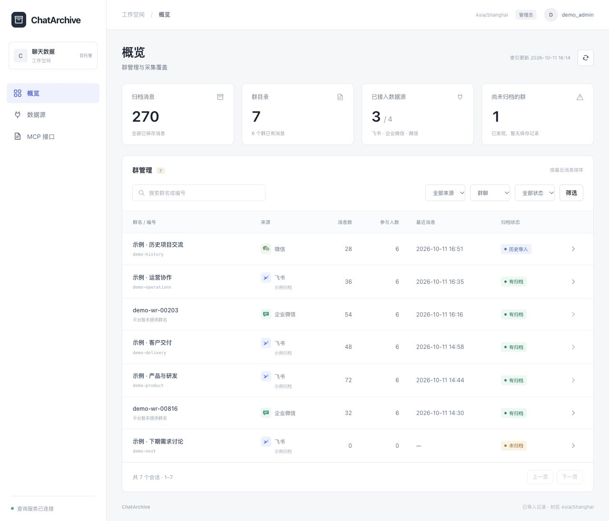
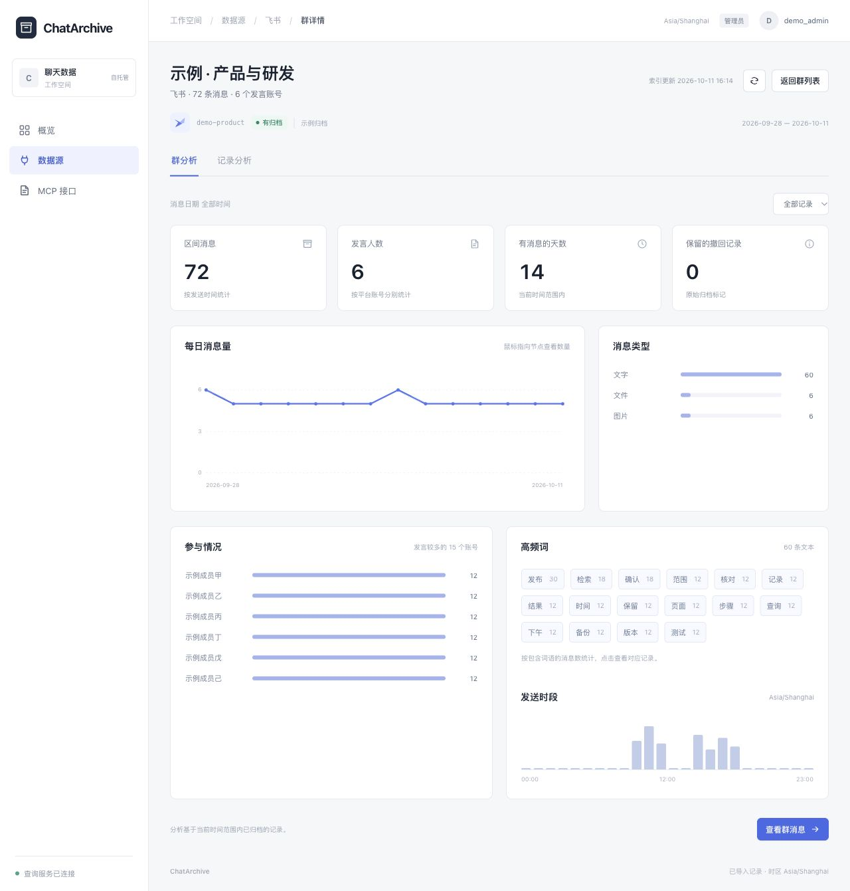
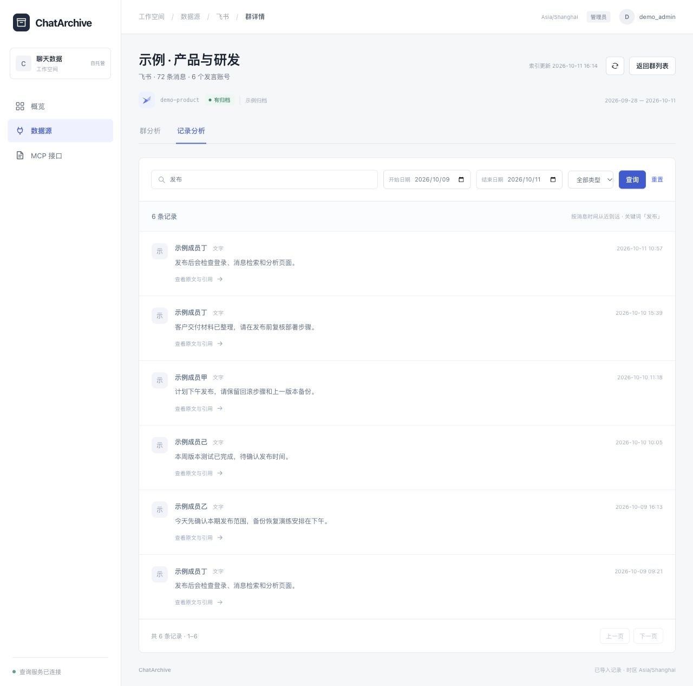

# ChatArchive

[English](README.md) · **简体中文**

[](https://github.com/daqianwenlv/ChatArchive/actions/workflows/checks.yml)
[](LICENSE)

**自托管的企业聊天记录查询与分析系统。**

将已有飞书、企业微信和微信历史归档整理到一个地方。通过群名或编号找到会话，检索消息原文、查看统计，并通过 HTTP API 或 MCP 把有权限的数据接入业务平台和 AI 工具。

当前版本：**0.2.3-preview.1，单工作空间查询预览版**。



*在同一个群目录中查看群名、编号、消息数和归档覆盖情况。以下均为实际运行截图，使用 7 个群、270 条消息的虚构示例数据。*

- **概览**：群目录、归档消息数、来源筛选和覆盖情况。
- **数据源**：飞书、企业微信、微信的已有记录导入与查询；群趋势、参与情况、消息类型和高频词。
- **MCP 接口**：五个只读工具，密钥限制数据源、群、权限和有效期，支持即时撤销。
- **账号**：本地管理员登录、首次改密、退出和会话撤销；可适配已有飞书管理员认证。
- **维护**：备份、校验、新目录恢复与诊断命令。

本版本读取已有聊天归档。原始事件留存、平台采集配置、成员角色、钉钉连接器与模型分析仍在后续计划中，见[功能边界](#功能边界)。

## 界面预览

### 群分析

进入群后，查看消息趋势、参与账号、消息类型和发送时段。点击高频词，可以继续查看对应的消息记录。



### 消息检索

按关键词、日期和消息类型筛选。每条结果保留发送人、时间，以及原文和引用信息的查看入口。



仓库提供了可复现这些页面的[展示数据](examples/showcase.jsonl)。启动后执行 `docker compose exec chatarchive python -m chatarchive.cli import-jsonl examples/showcase.jsonl` 即可导入。群分析选择「全部记录」；消息筛选使用示例日期 **2026-09-28 至 2026-10-11**。

## 快速开始：Docker Compose

需要 Docker Engine 和 Compose v2。克隆仓库；如已解压源码包，进入 `ChatArchive` 目录并跳过前两条命令：

```sh
git clone https://github.com/daqianwenlv/ChatArchive.git
cd ChatArchive
cp .env.example .env
docker compose build
docker compose run --rm chatarchive python -m chatarchive.cli init
docker compose run --rm chatarchive python -m chatarchive.accounts create admin
docker compose up -d --wait
```

创建账号时交互输入初始密码，至少 15 个字符。没有默认密码，也没有公开注册。打开 **http://127.0.0.1:8769/**，用刚创建的账号登录并更换密码。

如需先体验，导入完全虚构的样例：

```sh
docker compose exec chatarchive python -m chatarchive.cli import-jsonl examples/sample.jsonl
```

刷新页面，可看到 1 个示例群、2 条示例消息。重复导入不会增加消息数。示例只包含飞书格式记录；其他来源未配置时保持未连接。

Compose 默认只绑定本机。部署到域名时，先在 `.env` 设置实际的 `CHATARCHIVE_BASE_URL`，再使用带 TLS 的反向代理；子路径样例见 [deploy/nginx.conf.example](deploy/nginx.conf.example)。浏览器地址必须与配置一致，否则来源校验会拒绝登录。`CHATARCHIVE_PORT` 控制宿主机端口。

数据保存在命名卷中，容器重建不会清空记录。备份、恢复和更换服务器见 [BACKUP.md](docs/BACKUP.md)。

构建需要访问 Docker Hub 和 Python 包索引。如果 PyPI 下载缓慢，可在 `.env` 设置 `CHATARCHIVE_PIP_INDEX_URL` 为可用的公开 PyPI 镜像。依赖版本和发行文件哈希均已锁定，构建仍按 PyPI 官方公布的 SHA-256 验证文件；镜像提供的文件不匹配时安装会失败。

## Python 运行

支持 Python 3.12，Linux 或 macOS：

```sh
python3.12 -m venv .venv
.venv/bin/pip install -r requirements.lock
cp .env.example .env
set -a
. ./.env
set +a
.venv/bin/python -m chatarchive.cli init
.venv/bin/python -m chatarchive.accounts create admin
.venv/bin/python -m chatarchive.cli import-jsonl examples/sample.jsonl
.venv/bin/python -m uvicorn chatarchive.server:app --host 127.0.0.1 --port 8769 --no-access-log --no-proxy-headers
```

初始化仅用于新目录；如果已有数据库会退出并保留原数据。所有命令必须使用同一个 `CHATARCHIVE_DATA`。诊断命令：

```sh
.venv/bin/python -m chatarchive.maintenance doctor
```

## 导入自己的记录

JSONL 每行是一个群或消息对象，字段见 [API.md](docs/API.md)，格式参考 [examples/sample.jsonl](examples/sample.jsonl)。Python 部署：

```sh
.venv/bin/python -m chatarchive.cli import-jsonl /path/to/messages.jsonl
.venv/bin/python -m chatarchive.cli import-wecom /path/to/archive.sqlite3
```

Docker 部署可以把待导入文件只读挂载到临时命令容器：

```sh
docker compose run --rm -v /absolute/path/to/imports:/imports:ro chatarchive python -m chatarchive.cli import-jsonl /imports/messages.jsonl
```

容器用户须有文件读取权限。导入在临时数据库中完成，再原子替换查询索引；失败保留上一份快照，并发导入会被文件锁拒绝。通用导入保留现有消息，按 `(source, message_id)` 去重；不会把同名员工跨平台合并。

`import-wecom` 读取特定的存档 SQLite schema，并非任意企业微信数据库。旧系统全量快照桥接另见 [DEPLOYMENT.md](docs/DEPLOYMENT.md)，需要显式配置路径与身份文件，不应覆盖现有采集系统。

## 连接 MCP

在控制台的 **MCP 接口** 中创建密钥，选择数据源、群范围、查询权限与有效期。

- 端点：`<CHATARCHIVE_BASE_URL>/mcp/`
- 传输：Streamable HTTP
- 认证：`Authorization: Bearer <ACCESS_KEY>`
- 工具：`list_sources`、`list_groups`、`search_messages`、`get_message`、`analyze_group`

支持配置 HTTP Bearer 请求头的客户端可以连接。尚未提供 OAuth 自动授权发现。网页登录会话不用于 MCP。

本地 CLI 也可以生成密钥，令牌只写入指定的 0600 文件：

```sh
.venv/bin/python -m chatarchive.cli create-key --name demo-client --source feishu --group feishu:demo-project --days 7 --output ./demo-token.txt
.venv/bin/python examples/mcp_client.py --url http://127.0.0.1:8769/mcp/ --token-file ./demo-token.txt
```

示例使用官方 MCP Python 客户端完成初始化、工具发现与来源查询，不打印消息正文。AI 客户端应把聊天记录视为资料，引用消息 ID，并区分记录事实与推断。

## 功能边界

| 来源 / 功能 | 当前支持 | 尚未支持 |
| --- | --- | --- |
| 飞书 | 读取已有 chatlog JSONL、群目录、姓名及撤回标记；可合并 CLI 可见群 | 通用平台采集配置向导 |
| 企业微信 | 读取已有会话存档 SQLite；缺少群名时展示编号 | 自动申请存档权限、附件下载 |
| 微信 | 已有历史导出导入与统一检索 | 个人微信实时采集 |
| 钉钉 | 统一数据模型预留 | 采集连接器 |
| 用户 | 本地管理员账号、会话与密码管理 | 分级角色、成员邀请、MFA、多租户 |
| 分析 | 每日趋势、时段、类型、发言账号和带原文入口的高频词 | 模型生成报告、绩效评价 |

高频词只分析当前范围内最近最多 3000 条文本并显示样本数。缺失时间的消息可检索，但不计入按日统计。聊天活跃度不直接代表员工工作量或绩效。消息身份、日期范围与权限逻辑见 [API.md](docs/API.md)。

## 开发与发布检查

```sh
.venv/bin/pip install -r requirements.lock
.venv/bin/pip install -r requirements-dev.txt
.venv/bin/python -m pytest tests -q
node --check web/app.js
.venv/bin/python scripts/package_source.py
.venv/bin/python scripts/release_check.py
.venv/bin/python scripts/verify_docker.py --report docker-verification.json
```

最后一条命令需要 Docker，会创建独立测试容器和数据卷，只使用虚构数据，完成登录、查询、MCP、重建、备份恢复与回退检查后清理测试资源。完整流程见 [RELEASE.md](docs/RELEASE.md)。

代码组织：`query.py` 负责查询，`security.py` 限定访问范围，`accounts.py` 管理账号会话，`server.py` 暴露 HTTP/MCP，`maintenance.py` 负责备份恢复，`importer.py` 适配已有归档。

## 项目资料

- [部署与升级](docs/DEPLOYMENT.md)、[备份恢复](docs/BACKUP.md)、[发布流程](docs/RELEASE.md)、[本版验证记录](docs/VALIDATION.md)
- [贡献方式](CONTRIBUTING.md)、[安全报告](SECURITY.md)、[版本记录](CHANGELOG.md)、[第三方依赖](docs/THIRD_PARTY.md)
- [产品原则](docs/产品原则.md)、[服务器架构设计](docs/架构与接口草案.md)、[后续实施清单](docs/实施清单.md)

[MIT License](LICENSE)。运行数据、凭据、内部资料与生产配置不进入源码包。部署者使用自己有权处理的归档和平台账号。

官方仓库：[daqianwenlv/ChatArchive](https://github.com/daqianwenlv/ChatArchive)。[英文文档导航](README.md#documentation)。
