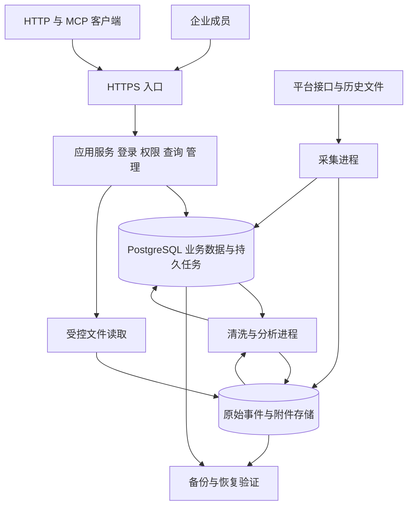
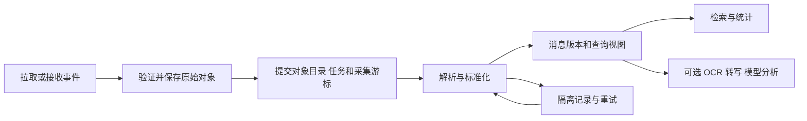

# ChatArchive 服务器架构

ChatArchive 保存授权范围内的聊天记录，为企业成员提供查询与分析，并通过 HTTP 和 MCP 向其他软件提供受控数据。服务器由身份与权限、数据源管理、原始归档、数据处理、查询与分析五个模块组成。管理页面是这些能力的操作入口。

本设计面向下一版后台，供公开评审。当前 0.2 查询预览版的已有能力见 [API](API.md)，发布条件见 [实施清单](实施清单.md)。本地管理员账号与可撤销会话已实现；本页中的分级成员体系、PostgreSQL、原始事件仓库和处理队列尚未实现。

## 当前实现与目标

| 领域 | 当前 0.2 | 下一版目标 |
| --- | --- | --- |
| 登录 | 本地管理员账号、首次改密、可撤销会话；可适配可信代理的飞书认证 | 所有者与分级成员、邀请、通用企业身份适配 |
| 权限 | 查询密钥按平台、群和工具权限限制 | 工作空间成员、角色、连接和群范围，界面与接口共用授权 |
| 数据源 | 既有库导入、CLI 发现群 | 每个平台多个连接实例，分别管理范围、游标和任务 |
| 原始数据 | 留在各采集系统；查询库保存抽取文本和部分元数据 | 原始事件、附件、来源、校验与保留策略 |
| 清洗 | 导入时抽取字段，统一少量消息类型 | 规则版本、处理状态、隔离记录、重放和差异对账 |
| 存储 | SQLite 查询快照、访问密钥及账号库；备份和新目录恢复 | PostgreSQL 保存业务数据与任务，文件存储保存原始对象 |
| 接口 | HTTP 查询、五个只读 MCP 工具 | 查询兼容、版本化管理接口、客户端授权发现 |

当前页面的“原文”是采集器提供的正文，不等同于完整的平台原始响应。旧采集器已经丢失的字段和附件，不能通过迁移重新生成；导入时必须标注实际保留内容。

## 部署结构

采用模块化单体：一个代码仓库和领域模型，API 与后台任务分别启动。标准开源部署面向一家企业的一个工作空间，业务表预留工作空间边界。跨企业托管须另行完成隔离、运维及容量验收，增加 workspace_id 不代表已经支持 SaaS。

| 运行单元 | 职责 | 扩展方式 |
| --- | --- | --- |
| HTTPS 入口 | TLS、请求大小限制、可信代理边界 | 沿用部署者的反向代理 |
| 应用服务 | 登录、成员、授权、连接管理、查询、HTTP/MCP、任务提交 | 压力测试后增加实例 |
| 采集进程 | 平台调用、补采、游标、附件下载 | 按连接限流和分配任务 |
| 处理进程 | 标准化、索引、统计、重放；可选 OCR 与模型任务 | 按任务类型独立并发 |
| PostgreSQL | 用户、连接、对象目录、消息、任务与审计 | 先单实例，依据实际负载扩展 |
| 私有文件存储 | 原始批次、附件、派生文件和临时导出 | 默认持久目录，可选 S3 兼容存储 |

以上可以先在同一台服务器部署。增加存储层不等于马上增加一台存储服务器。数据库、数据目录和密钥独立于应用发布目录；代码升级不覆盖它们。备份应在不同故障域，同一块磁盘的另一个目录不构成灾难恢复。

下一版选择 PostgreSQL，主要用于多用户授权、并发任务、持续写入和消息版本事务。当前 SQLite 继续服务查询预览；迁移后以 PostgreSQL 为唯一标准生产数据库，避免同时维护两套完整后台语义。

首版使用 PostgreSQL 持久任务表，保存租约、心跳、尝试次数、下次执行时间和错误分类。工作进程短事务领取任务后释放锁，网络调用期间不持有锁。`SKIP LOCKED` 可用于多个消费者领取队列行，不能用于替代普通查询的一致性要求。[PostgreSQL SELECT](https://www.postgresql.org/docs/current/sql-select.html)

Redis、Kafka、搜索集群和向量库不作为首版启动依赖。中文检索先保留字面匹配和经过实测的索引方案；是否增加分词搜索或独立搜索服务，依据真实检索质量、延迟和负载决定。

## 用户登录与权限

### 登录身份与采集凭据

成员登录后成为内部 user；飞书应用或企微存档凭据属于 source_connection。能够用飞书登录，不等于可以查看全部飞书群；机器人配置权限也不自动授予正文读取权限。

通用企业身份通过 OIDC 适配；飞书等专用登录使用独立适配器，不假定平台都提供相同的 OIDC 接口。外部身份以提供方和稳定主体 ID 绑定内部用户，不按姓名或未经验证的邮箱合并。[OpenID Connect Core](https://openid.net/specs/openid-connect-core-1_0.html)

目标版本的独立部署提供一次性安装引导，创建第一位所有者后关闭入口。默认不开放公共注册，成员由邀请加入。没有企业身份服务时可使用本地账号，密码仅保存专用密码哈希，并提供限流、恢复和会话撤销。当前预览版已支持在服务器创建管理员账号，尚无安装引导和分级成员权限。

浏览器使用随机会话标识，服务端保存可撤销会话。cookie 使用 HttpOnly、Secure 和适当的 SameSite，写操作校验 CSRF；登录和提权后轮换会话。退出、停用成员和密码重置撤销相应会话。建议初始策略为闲置 30 分钟、最长 8 小时，可由部署者调整。[OWASP 会话管理](https://cheatsheetseries.owasp.org/cheatsheets/Session_Management_Cheat_Sheet.html)

### 角色与数据范围

角色定义能执行的操作，范围定义可以访问的连接和群。实际权限取工作空间成员身份、角色、数据授权的交集；服务账号再叠加密钥范围及有效期。群目录、数量和统计也受范围限制。

| 角色 | 默认能力 | 正文访问 |
| --- | --- | --- |
| 所有者 | 成员、角色、连接、保留与恢复策略 | 可授权；原始负载下载单独授权和审计 |
| 数据管理员 | 连接配置、群选择、任务重试、质量检查 | 不因运维角色自动获得，可叠加授权 |
| 分析成员 | 获授权群、消息与统计 | 限定范围；导出和原始负载另行授权 |
| 服务账号 | HTTP 或 MCP 自动查询 | 限定连接、群与工具；不能管理用户和平台凭据 |

目录读取、正文读取、统计分析、原始对象读取、导出、连接管理、成员管理和授权管理分别控制。可看统计不一定可看高频词、发言者明细和引用，这些可能暴露内容，需要额外权限。

业务层统一授权，数据库工作空间行级策略作为第二道边界。应用账号不是表所有者且不带 BYPASSRLS，迁移和备份使用独立身份；连接池在每个事务设置并清除工作空间上下文。PostgreSQL 的表所有者和特权角色能够绕过部分行级限制，必须验证实际运行角色。[PostgreSQL 行级安全](https://www.postgresql.org/docs/current/ddl-rowsecurity.html)

## 数据存储分层

| 数据层 | 内容 | 位置 | 更新与恢复 |
| --- | --- | --- | --- |
| 原始层 | 有效平台事件、加密报文、导入文件和附件原件 | 私有文件存储；数据库保存位置、校验及批次 | 保留期内追加，不被清洗覆盖 |
| 标准层 | 群、账号、消息、编辑版本、回复关系、时间和媒体引用 | PostgreSQL | 从原始层生成，可按规则重放 |
| 服务层 | 搜索字段、统计、OCR、转写、模型结果及证据 | PostgreSQL；大文件进私有文件存储 | 可重建，记录规则和输入版本 |
| 管理层 | 用户、授权、连接、凭据引用、游标、任务和审计 | PostgreSQL；密钥由独立密钥配置管理 | 独立备份，不能靠重放消息恢复 |

先存原始数据，再清洗，是先持久保存有效平台负载，再异步处理。签名、授权、重放防护和请求大小检查仍在写入之前完成。Authorization、cookie、访问令牌等传输凭据不进入原始归档。

对象按工作空间、连接、日期和批次组织，使用系统生成的对象名；平台文件名不能直接成为存储路径。保存内容校验、大小、媒体类型、加密与保留信息。附件区分待下载、已保存、下载失败、平台已失效和旧系统未保留。

原始事件目录记录对象键、分片内定位和单条负载校验，使消息能回到原始批次中的明确记录。采集批次、加密报文和解密后的内容是不同对象或处理版本；需要重新解密时能够定位原报文和所需密钥版本。

平台凭据使用可轮换的密钥引用，受控解密只发生在对应采集进程。数据加密密钥和平台凭据分开管理，主密钥不与密文放在同一数据库或源码包中；备份必须有独立可恢复的密钥保管方案。

浏览器不直接读取服务器目录或长期公开链接。原始对象检查单独授权；常规成员查看正文与必要出处。默认文件下载经过应用代理重新鉴权；大文件可选短期签名 URL，但应明确到期前的访问风险，不能承诺签发后立即撤销。

## 采集与清洗

### 耐久写入与断点恢复

1. 按连接和分区领取任务，记录游标起点、范围、运行 ID 和适配器版本。
2. 原始对象耐久写入后验证校验值。本地文件使用临时文件、文件刷盘、原子替换及目录刷盘；对象存储使用稳定对象键并确认写入完成。
3. 在一个数据库事务中提交对象目录、原始事件、待处理任务与采集游标。持久任务表兼作事务内任务发件箱，不依赖一次内存通知。
4. 提交后才确认推送或继续下一轮拉取。清洗进度单独记录，不能拿清洗时间替代采集游标。
5. 工作进程崩溃后租约到期重领。采用至少一次投递和幂等处理，不承诺全链路恰好一次。

文件存储和数据库没有共同事务。对象写入后数据库失败，留下可核对的孤立对象；重试复用稳定对象键。后台只清理超过宽限期且没有目录引用的对象。数据库不能先提交一个尚未实际存在的原始对象。

### 清洗规则

| 步骤 | 处理方式 | 保真要求 |
| --- | --- | --- |
| 格式校验 | 识别字段、事件版本、缺失与异常大小 | 无法解析的有效负载进隔离区，不静默丢弃 |
| 消息识别 | 按来源命名空间、平台 ID 与版本识别重复、编辑和撤回 | 文本相同不代表相同消息 |
| 时间统一 | 标准 UTC、原时间、时区与精度并存 | 无效或缺失时间不填成当前时间 |
| 内容解析 | 文本、富文本、引用、附件形成有序内容块，另生成搜索文本 | 保留原结构，禁止执行消息 HTML |
| 群和账号 | 平台 ID、名称历史、连接身份与观察时间 | 同名不合并，缺名不猜测 |
| 类型统一 | 平台类型映射标准类型，保留原类型 | 未知类型仍保留并标记 |
| 媒体处理 | 独立下载、校验和重试，后续可识别 | 无下载结果不写“已保存”，识别结果不覆盖原件 |
| 隐私视图 | 展示、导出或分析输入按策略生成脱敏视图 | 不以脱敏结果替换原始层；原始层仍受权限与保留约束 |

处理结果记录原始事件 ID、解析器和规则版本、输入校验、输出版本、起止时间与错误码。规则更新后创建新的处理批次，比较消息数、正文校验、时间及引用差异，通过后切换服务视图；旧版本按策略保留用于回退。

OCR、转写、摘要和任务提取属于派生处理。它们可以失败或关闭，不阻塞归档查询。没有证据的推断不写回“已完成”“责任人”等事实字段。

### 重复与消息版本

原始事件使用连接、事件标识、类型和负载校验识别重复投递。无事件 ID 时由适配器生成稳定指纹并记录算法版本。标准消息有稳定内部 ID，编辑、撤回形成新版本，证据引用明确消息版本。

多个机器人可能采到同一条消息。默认按连接区分；只有确认租户、ID 命名空间和消息身份一致，才能把来源观察关联到同一标准消息。用户 ID 也可能只在应用内有效，不能按名字或相同字符串跨应用合并。

合并后仍保留各连接的来源及可见范围。某连接采到更完整内容，不代表其他连接的获授权用户可以看到。无法确认先后的冲突版本保留冲突，不能用采集时间强行判定最新编辑。

撤回影响默认展示，原始版本是否继续保留取决于工作空间策略。平台撤回、管理员删除和保留期到期分别记录。原始层保留期内防止被处理程序覆盖，不意味着永久不可删除。

## 数据源管理

“飞书”是平台类型，“飞书连接 A”和“飞书连接 B”是独立连接。每个连接有凭据引用、主体、授权范围、采集选择、游标、任务和保留策略。平台卡片汇总连接，进入后仍以群分析、记录分析为主要使用路径。

新增流程：选择适配器 → 验证主体与权限 → 发现可见群 → 选择范围和起点 → 预览覆盖及限制 → 启动同步。凭据提交后不回显，只返回是否配置及验证结果。更换账号先核对平台主体，不能静默复用旧游标。

| 对象 | 必须显示的状态 |
| --- | --- |
| 连接 | 未配置、验证失败、已验证、同步中、部分失败、已暂停、需重新授权 |
| 群 | 可见、已选择采集、有记录、历史缺口；名称与编号并列 |
| 采集任务 | 最近尝试、最近成功、游标、取回数、新事件数、重复数、错误和重试 |
| 处理任务 | 已归档未处理、已可查询、处理失败、重放中、规则版本 |
| 媒体 | 待下载、已保存、失败、不可恢复的数量与原因 |

连接验证成功不能显示为全部已采集。无新消息但轮询成功属于健康状态。一个来源失败不阻断其他来源更新，展示其最后成功版本与延迟。

暂停采集不删除记录；删除连接先停用，数据处理是单独操作。所有可见群不自动成为获批准的采集范围。后续个人微信设备代理应以限定连接身份上传事件；服务端不伪装成已有设备采集能力。每个适配器声明群发现、历史、增量、推送、附件等实际能力和限制。

## 领域对象与约束

| 对象 | 关键关联与约束 |
| --- | --- |
| workspace / user / membership | 成员隶属工作空间，停用后失去访问 |
| external_identity / session | 提供方与稳定主体 ID 唯一，会话可撤销 |
| role / data_grant / service_account | 操作与连接、群范围分别授予，不可转授超出自身可授予范围的权限 |
| source_connection / secret_ref | 平台、主体、实例、凭据引用与配置版本 |
| conversation / source_conversation | 内部群与来源观察关联，名称不作为身份 |
| actor / source_actor / identity_mapping | 平台账号与人工确认的跨平台映射分离，保留依据 |
| raw_object / raw_event / ingestion_run | 对象校验、批次、事件身份、来源及原始完整程度 |
| message / message_version / message_observation | 当前视图、历史版本、连接来源与原始事件引用 |
| attachment / derived_artifact | 原件与派生结果分离，派生结果记录输入版本 |
| job / job_attempt / cursor | 持久任务、尝试、租约、独立采集进度，连接或分区互斥 |
| processing_run / data_issue | 规则版本、隔离记录、重放差异和结果 |
| analysis_run / evidence | 输入快照、权限范围、模型及模板版本、消息版本引用 |
| audit_event / retention_policy / deletion_job | 操作审计、保留与可验证删除进度 |

业务表带 workspace_id，跨表外键包含该字段。消息唯一键由工作空间、适配器确认的身份命名空间和平台消息 ID 组成；未确认命名空间时包含 connection_id。不能沿用查询预览版仅 source + message_id 的去重键作为多连接通用保证。

缓存键包含工作空间、数据范围、权限版本与数据版本。搜索、聚合、导出和分析证据执行相同边界，不跨工作空间共享原始文件或分析缓存。

## 查询接口与模型分析

保留五个只读 MCP 工具及现有 HTTP 查询，新增管理接口置于 `/api/v1`，旧路径由兼容层过渡。页面、HTTP 与 MCP 调用统一授权服务，不能各写一套过滤。导出和耗时分析提交任务，查询线程只返回任务 ID 与状态。

浏览器会话、平台采集令牌和机器查询凭据互不复用。当前 Bearer 密钥适用于支持自定义请求头的客户端。面向更多 MCP 客户端时增加 OAuth 授权服务接入、受保护资源元数据、用户授权和令牌受众校验；现有代码没有授权发现，不声称通用客户端免配置接入。[MCP 授权规范](https://modelcontextprotocol.io/specification/2026-07-28/basic/authorization)

模型分析按“选择数据范围 → 显示覆盖与模型目的地 → 创建任务 → 展示带证据结果”组织。部署者配置允许的模型和数据用途，默认关闭外部模型发送。正文中的指令是不可信内容，不触发系统操作。

分析保存消息版本、过滤范围、时区、模型、提示模板、时间和证据。提交、执行及结果读取时均重新检查权限。成员停用后，排队任务不得继续发送数据。报告只有在用户仍可访问全部输入范围时才可读取；需要更小范围时重新生成，不直接裁剪可能包含越权证据的结论。

消息数和发言时段属于沟通统计，不直接变成员工绩效分数。事项、承诺和进展分析呈现证据与待确认项，记录无法证明的结论保持未知。

## 留存与运维

原始记录、附件、标准消息、派生结果、导出和审计分别设置期限。初始可不自动清理，由所有者完成保留配置；存储不足告警并受控暂停采集，不能擅自删除旧记录。

删除任务先撤销查询可见性，再处理原始对象、版本、附件、索引、缓存和派生结果。批次内含其他需保留记录时，先重写保留对象与目录，再处置旧对象；共享附件按引用处理。备份按期限过期，独立保留删除清单，恢复后先应用清单再开放访问。不承诺即时清除所有历史备份。

监测采集滞后、归档到可查询延迟、失败任务、隔离记录、缺失附件、空间、数据库与接口状态。存活与就绪检查分开，不能把进程运行等同于数据完整。

备份包含数据库、对象目录、对象内容、配置和可恢复密钥。密钥与数据分开保管；恢复演练验证校验、游标、用户授权与抽样引用。清洗可重放不代表无需备份，搜索索引不能完整恢复授权、游标和原始数据。

## 实施顺序与迁移

先实现原始归档、来源追踪和稳定领域模型，再实现用户授权、连接管理和清洗重放。在开放更多成员登录前完成权限隔离。详细发布门槛见 [实施清单](实施清单.md)。

旧系统只读导入，新旧查询并行对账。旧记录标注 original_payload、normalized_export 或 partial_legacy 等实际来源等级。切换前按同一范围核对计数、版本、正文及引用；保留旧查询用于回退。初期不迁走旧采集器，避免一次不可回退的整体替换。
